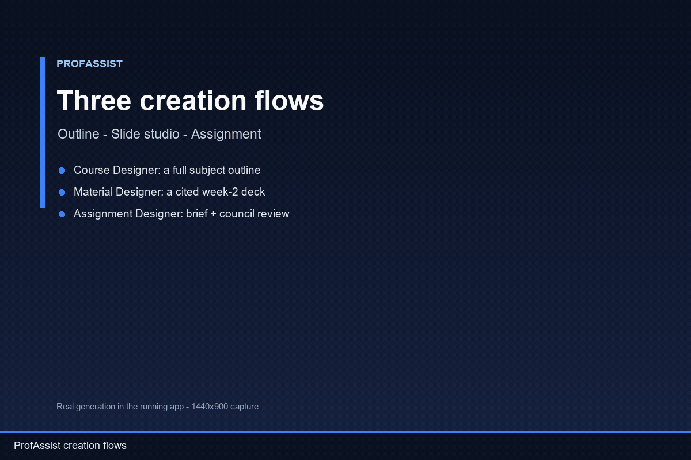
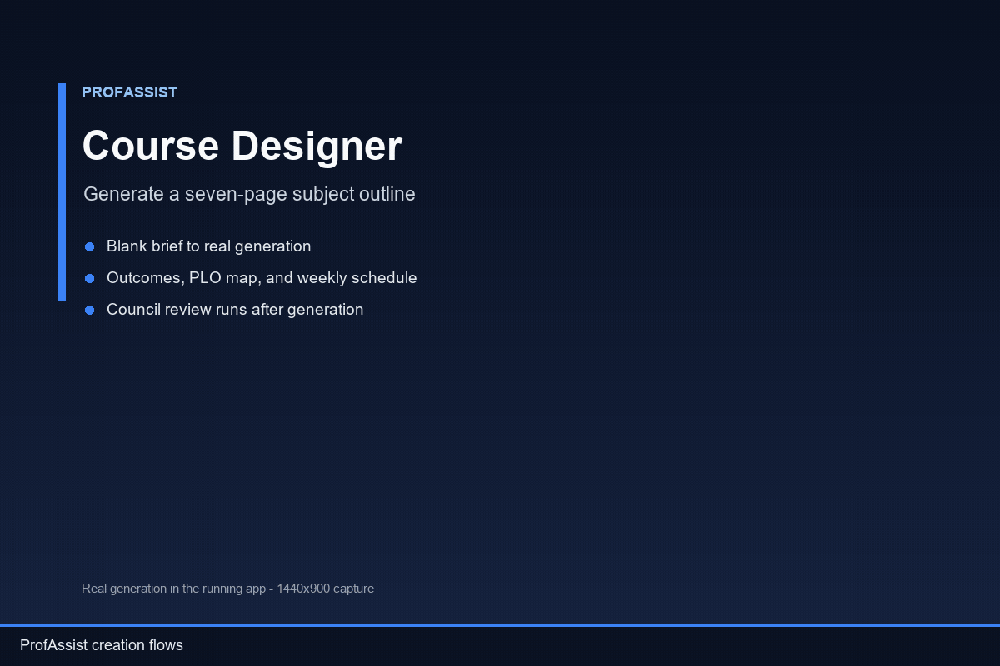
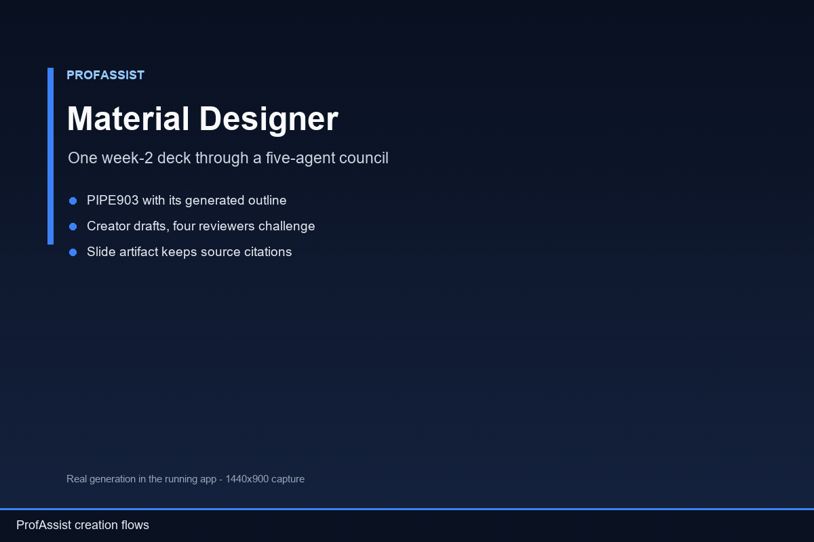
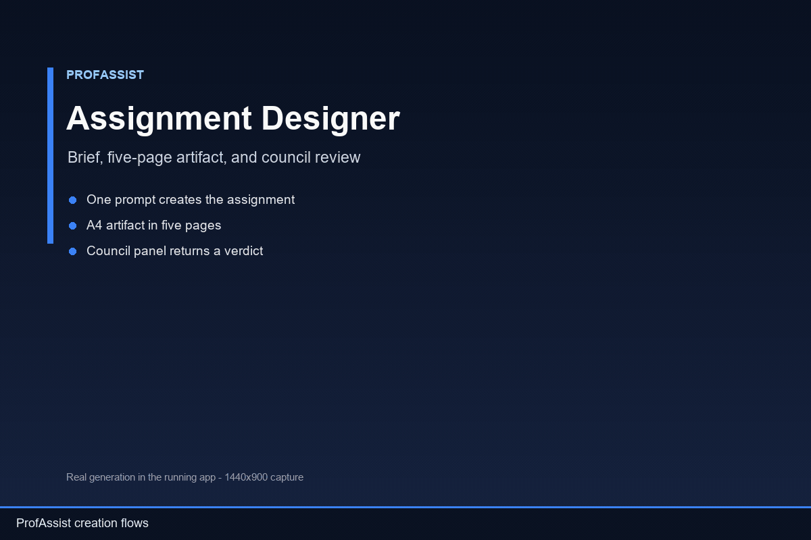
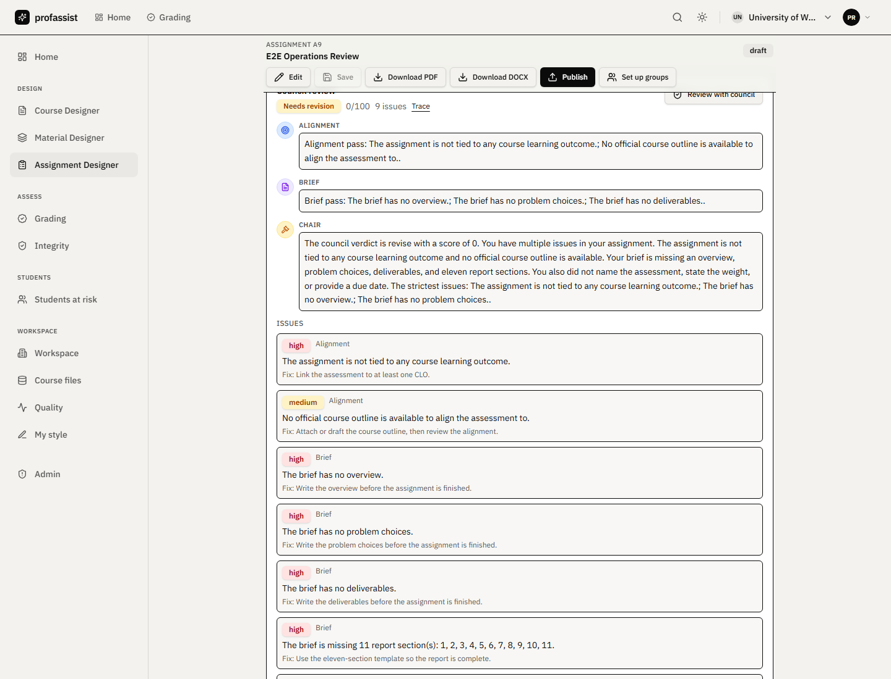

# ProfAssist

**AI workspace for Dr Patrick Mukala, University of Wollongong in Dubai (UOWD) - course MAAI904.**

Proof of concept (POC), built on the [Vstorm full-stack AI agent template](https://github.com/vstorm-co/full-stack-ai-agent-template) (FastAPI + Next.js + LangGraph). One professor drafts course material with a council of LLM reviewers and a human approval gate; every artifact stays a draft.

- **Outline** - a ten-step subject outline with CLOs/PLOs, weekly schedule, readings, assessment map, and PDF/DOCX export.
- **Cited decks** - a week of notes becomes a slide deck with source passages, speaker notes, gap notes, and PowerPoint export.
- **Assignment + rubric + council** - brief, exemplars, group allocation, a four-level rubric, and a council review before publishing.
- **Grade, integrity, dropout** - an advisory grading council with verbatim quotes, a DB-backed similarity board, and a course-withdrawal early warning.

## Watch the GIFs









Real captures from the running local Docker app (demo course). Council verdicts are advisory; many drafts land as "Needs revision" by design.

## Quick start

```bash
cp .env.example .env          # then set GEMINI_API_KEY=...
make demo                     # Windows: powershell -ExecutionPolicy Bypass -File scripts/demo.ps1
# open http://localhost:3000/register - the first user becomes the app admin
```

Docker Desktop (or Docker Engine + Compose v2) and a Google AI Studio key are the only prerequisites. The stack builds, runs `alembic upgrade head`, and waits for `/api/v1/health`; the first start is slow. `docker compose up -d --build` is equivalent to `make demo`. Register before sharing the URL: the first account is promoted to app-admin.

Stop the stack with `make demo-down`; tail logs with `make demo-logs`.

## Screens

| Sign in | Councils - Material |
|---|---|
|  |  |
| Form starts empty; register first, there are no demo credentials. | Creator -> Curriculum -> Evidence -> Design -> Chair, each with its own model and prompt. |

| Material Designer - live council | Assignment council |
|---|---|
|  |  |
| Creator, enabled reviewers, then Chair; deck ready at 80/100. | With Rubric disabled, only Alignment, Brief, and Chair speak. |

| Integrity - DB-backed board | Students - dropout early warning |
|---|---|
|  |  |
| Six groups, three pairs, real submission text; flags are evidence, not guilt. | Synthetic demo model: 5 review / 7 routine (High/Low in the UI). No enrolment or mark changes. |

All screens come from the local demo course. The left sidebar is the only workspace navigation; the top bar carries utilities only.

## What you get

| Surface | Route | What the professor gets |
|---|---|---|
| **Course Designer** | `/outline` | Ten-step outline: details, CLOs/PLOs, weekly schedule, readings, assessment map, policies, PDF/DOCX. |
| **Material Designer** | `/studio` | Cited deck for a week: speaker notes, source passages, gap notes, PowerPoint export. |
| **Assignment + Rubric** | `/assignments`, `/rubric` | Brief, exemplars, group allocation, four-level rubric, council review, import from paste/DOCX/PDF/XLSX. |
| **Grading** | `/grade` | Council votes per criterion with verbatim quotes, a judge, then a professor edit and explicit push. |
| **Integrity + Students** | `/integrity`, `/students` | DB-backed flags with side-by-side pairs and viva questions; advisory withdrawal risk with data-gap states. |
| **Admin** | `/admin/*` | Councils, AI settings, ML models, Moodle connection, users and organization. |

Every surface writes drafts only; publishing, a grade push, and delete actions require explicit confirmation.

## Councils

All council roles are LLM agents; there are no code-check roles. Each role carries its own prompt, provider, and model, and the chair always speaks last.

- Edit at **`/admin/councils`** (app admins, scoped to the active organization): add a custom LLM reviewer, remove, reorder, enable/disable, edit the persona prompt, choose the model.
- Left-to-right is the speaking order. Exactly one chair is required per council, and a disabled role does not speak.
- Default rosters: Material `Creator -> Curriculum -> Evidence -> Design -> Chair`; Assignment `Creator -> Alignment -> Brief -> Rubric -> Chair`; Grading `Evidence / Strict / Supportive -> Chair judge`; Outline `Creator -> Curriculum -> Alignment -> Balance -> Student -> Chair`.
- The roster and council prompts are Postgres (`pa_council_roles`); **Reset** deletes the organization's rows so the code default speaks again.
- Global agent prompts live in Langfuse (`production` -> database version -> code default). Faculty edits land in Langfuse; see [docs/prompts.md](docs/prompts.md).

## ML / Moodle / Memory

**Machine learning** ([docs/ml.md](docs/ml.md))

- `student-dropout` predicts course withdrawal only (not pass/fail), from a synthetic demo artifact, threshold `0.1`; all 14 features are required, so a missing one is a data gap, not a low score.
- `passage-reuse` is an external worker contract: without `PLAGIARISM_WORKER_URL` it stays `not_installed` and scoring returns a fixed `503`.
- MLflow is a tracking server; no training run is registered, and no model predicts a pass or a fail.

**Moodle** ([docs/moodle-connector.md](docs/moodle-connector.md))

- Per-university connection at `/admin/integrations/moodle`: site URL, Fernet-encrypted token, course scope, push flag, and a five-item **Test connection** checklist.
- Reads courses, students, assessments, submissions, files, rubrics, and workshops into Postgres; Prefect syncs every 30 minutes plus a nightly full run, and **Sync now** is the manual backup.
- Push is off (`MOODLE_PUSH_ENABLED=false`); a grade reaches Moodle only after professor approval and admin enablement. The bundled simulator runs on port 8090.

**Memory and prompts** ([docs/memory.md](docs/memory.md))

- Postgres is the source of truth (`pa_memories`); Qdrant and optional Mem0 are mirrors, and a mirror failure is logged while Postgres still answers.
- Every draft gets that professor's `soul.md`, About me portrait, and labelled memories - never another professor's. Memory text is PII-scrubbed before storage.
- Reflection auto-applies: the portrait is rewritten and the previous wording stays in history (`/style` has no Approve button).

## Testing

**1120 backend tests passed, 4 skipped** (`uv run --frozen pytest -q`) and **117 frontend tests** (`npx vitest run`); type-check exits 0, ESLint has 0 errors and 2 warnings. The 4 skips are destructive Alembic migration tests that need `TEST_DATABASE_URL`.

- CI runs Ruff, type check, the backend suite, and frontend type-check/lint/build; it does not run a Playwright journey.
- The E2E in the testing pack is a local manual run against mocked Moodle only.
- The backend suite uses a mocked async session, so it needs no Postgres, Redis, Qdrant, MinIO, or model key.

The local E2E run, traces, screenshots, GIF captures, failures, and fixes are in **[docs/testing-pack.md](docs/testing-pack.md)**.

## Limits

- **Mock Moodle only.** No live Moodle site or live grade push was exercised; `MOODLE_PUSH_ENABLED=false` by default.
- **Plagiarism worker not installed.** No model, artifacts, or scores ship here; `passage-reuse` stays `not_installed`.
- **Dropout is synthetic and withdrawal-only.** A 480-row seeded bundle, no pass/fail model, no training loop, no promotion.
- **No real student records.** The vendored `student-dropout` port has no upstream LICENSE file, so redistribution or production use needs written permission from the upstream author.

## Docs

- [Architecture](docs/architecture.md) - layers, auth, files, RAG.
- [ML](docs/ml.md) and [Moodle connector](docs/moodle-connector.md) - model and sync contracts.
- [Memory](docs/memory.md) and [Prompts](docs/prompts.md) - Postgres/Qdrant/Mem0, Langfuse fallback order.
- [Testing pack](docs/testing-pack.md), [Configuration](docs/configuration.md), [Commands](docs/commands.md), [Permissions](docs/permissions.md), [Security](SECURITY.md).
- [Status vs design](docs/STATUS_VS_DESIGN.md) - what is done, partial, stubbed, or not done.

License: MIT for the template and this repository ([LICENSE](LICENSE)); the `student-dropout` upstream port is excluded from redistribution.